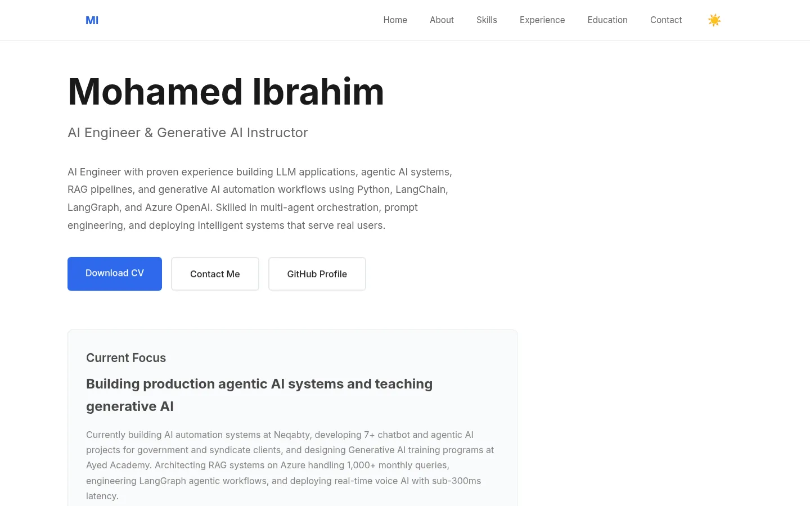
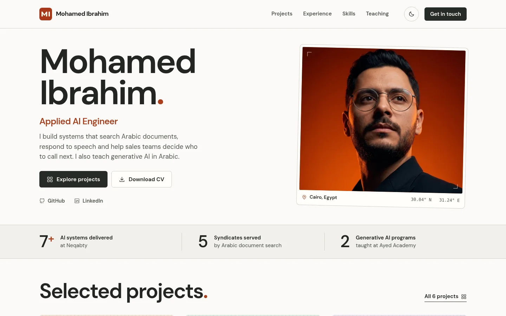
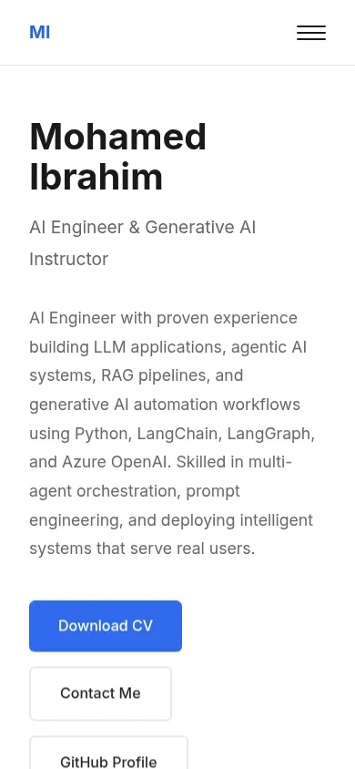
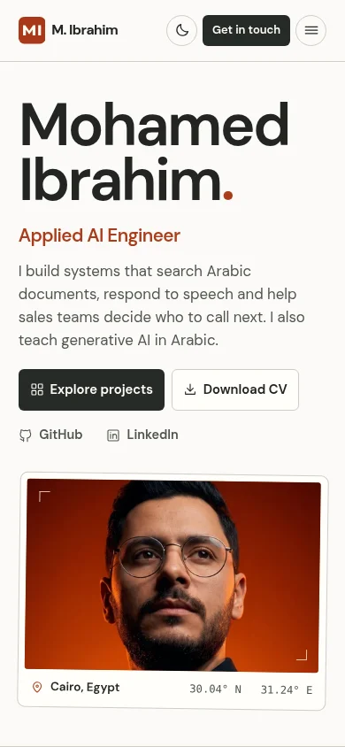

# Before and after

Both versions were captured in Chromium using a 1440 × 900 desktop viewport and a 390 × 844 phone viewport. The before images show the live portfolio as audited on 25 November 2026. The after images show the review branch served under `/Portfolio/`.

| View | Before | After |
| --- | --- | --- |
| Desktop homepage |  |  |
| Mobile homepage |  |  |

| Recruiter task | Before | After |
| --- | --- | --- |
| Understand Mohamed’s work | Long opening summary followed by repeated current-focus copy. | Portrait, concise engineering focus, three CV-backed indicators and direct project access. |
| Investigate a project | Experience descriptions on one page. | Filterable index and six linkable case studies with responsibilities, architecture and evidence. |
| Verify a claim | PDF and general profile links. | Updated CV, revision-specific evaluation documents and a live education platform. |
| Check teaching and achievements | Text lists within education and experience. | Dedicated teaching section, live product, recognition groups and extensible proof media. |
| Review on a phone or with JavaScript disabled | Mobile navigation depended on the menu script. | HTML links and disclosures remain available, with optional client-side navigation and filtering. |

[Dark homepage](review/after-dark.webp) · [Project index](review/projects.webp) · [Case study on tablet](review/case-study.webp)
